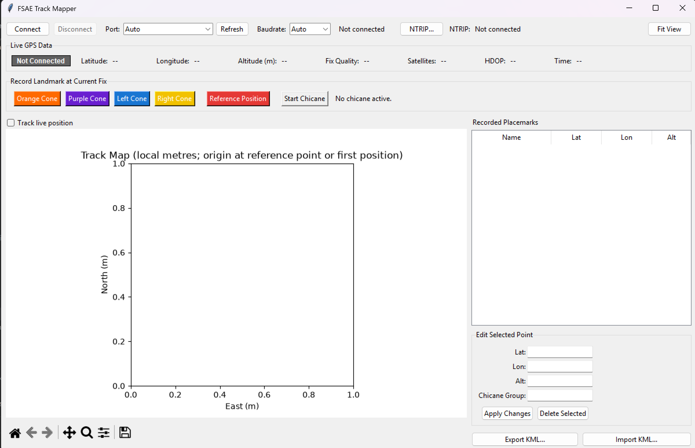

**What is it?**
The FSAE Track Mapper is an application which gathers and records GPS locations of track features and exports a .kml file which can be used by the **[FSAE_track_virtualiser](https://github.com/cakemun/FSAE_track_virtualiser)** (will be made public shortly)

**Who's It For**
This application is intended for race operations members who wish to improve driver training through virtualisation of track features. (cones)

## Quick Start

**Disclaimer: This Program was developed solely with a LC29H GPS module**

1. Run the GUI.py script, you should be greeted with the GUI interface of the application
2. Ensure your GPS device is connected to your computer via USB, if you know the baudrate and Port of your GPS it is suggested to select the specified details. Alternatively the GPS should be discovered by the automatic settings.
3. For maximum precision, it is suggested to connect to an NTRIP server - in Australia, Geoscience Australia offers a huge network of Free NTRIP servers for RTK adjustments. 
4. The GPS status is displayed in the top corner, for maximum precision, allow for the GPS to reach RTK lock.
5. To record track features press the orange, purple, left or right cone features. Once pressed the map should place cone feature. 
6. Continue process until track is mapped, then press export .kml to export features - it is recommended to occasionally export .kml files as data is not cached.

# Key Features

The GPS configuration is specified top of the window and below it is the live GPS data readout including live GPS lock status, position, satellite count, HDOP, and time. You can connect to an NTRIP server via pressing the NTRIP button and providing your credentials.

Below the live GPS readout is the recording banner which contains the list of recordable options for the track features including: orange, purple, left, right cones, and reference position. In addition, you can select to start a chicane feature. 

Below the selection banner is the Live track map. The map displays the live position of track features and can be navigated to highlight and modify recorded features. Additionally, the map can be set to centre on the live position via the top left checkbox.

The track features are displayed and can be modified in the recorded placements box and once mapping has being complete you can export 